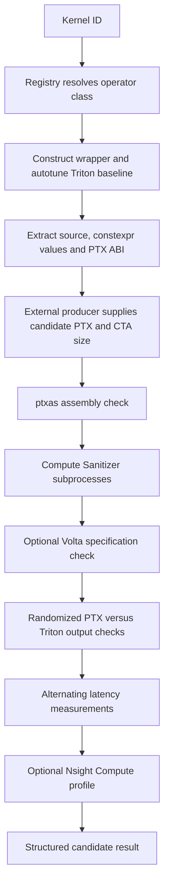

# Understanding PTX Gym

PTX Gym evaluates a replacement PTX program for a fixed Triton workload. It
provides inputs, a launch interface, a tuned compiler-generated baseline, and
correctness/performance feedback. An external agent can generate candidates;
the Gym itself contains no search policy or training loop. The separate
[Triton AI Compiler](https://github.com/francois141/triton_ai_compiler) uses this
environment to do that search.

Read this guide first, then the [HVP benchmark](softmax_ce_hvp.md) and
[local/remote runbook](run_softmax_ce_hvp.md). Links into source are relative to
this checkout so they follow the code you are actually running.

## 1. The repository in one map

| Location | Responsibility | Start here when… |
| --- | --- | --- |
| [README](../README.md), [quick_start.py](../quick_start.py) | Public usage examples | Running an existing task |
| [ptx_gym/api.py](../ptx_gym/api.py) | JSON-compatible Python API and process-local caches | Connecting an agent or client |
| [kernels](../ptx_gym/kernels) | Workload registry and operator wrappers | Adding a benchmark |
| [kernels/base.py](../ptx_gym/kernels/base.py) | Shared JIT, tuning and PTX-launch lifecycle | Understanding what every wrapper must implement |
| [helpers](../ptx_gym/helpers) | Source extraction, PTX signatures, environment, serialization | Inspecting the compilation contract |
| [evaluation](../ptx_gym/evaluation) | Assembly, sanitizers, numerical checks, timing, profiles | Understanding a candidate verdict |
| [server.py](../ptx_gym/server.py) | Flask transport around the Python API | Evaluating from another process/machine |
| [triton_src](../triton_src) | Vendored, patched Triton source | Building or debugging PTX injection |
| [setup.py](../setup.py), [pyproject.toml](../pyproject.toml) | Delegate packaging to the vendored Triton build | Installing the GPU environment |

The kernel registry has `common`, `papers`, `random`, and `adversial` groups
(the last spelling is the repository's spelling). Common kernels are small
operations; paper kernels are larger published workloads. Random/adversial
tasks test whether a translator follows the actual code rather than a familiar
name or misleading comment. Registration is explicit in
[kernels/__init__.py](../ptx_gym/kernels/__init__.py), not automatic discovery.

`triton_src` is tracked source in this repository, not the normal pip Triton
dependency. The optional Volta integration is separate; `.gitmodules` contains
a Volta entry, but this checkout does not provide a ready-to-run Volta binary.

## 2. What stays fixed during an experiment?

The README calls the compilation contract `(c, I, h)`:

| Part | Meaning | Example |
| --- | --- | --- |
| `c` | Compile-time constants and the workload's fixed problem configuration | `BLOCK_SIZE=256`, FP16 input, 4,096 rows |
| `I` | Argument ABI and launch interface | Pointer/scalar argument order, grid dimensions, candidate CTA dimensions |
| `h` | Target device and assembly environment | A detected target such as `sm_121a` |

A wrapper controls the grid and Python arguments. A candidate supplies a full
PTX module and CTA dimensions. It may reorganize work within that interface,
but cannot change what the operation computes or reinterpret its arguments.
PTX entry parameter order/types must match the reference signature. The entry
name must also remain compatible with the generated launcher: retaining the
reference entry name is the straightforward choice.

`num_warps` describes the Triton baseline. Normally its CTA has
`32 * num_warps` threads. A candidate may supply different `threads_x/y/z`
(dict aliases are `num_threads_x/y/z`), with at most 1,024 total threads and
dimensions consistent with PTX `.reqntid`/`.maxntid` declarations. This does not
give the candidate permission to change the wrapper's grid.

## 3. Follow an existing softmax task from beginning to end

The example is
[SoftmaxFloat16Kernel](../ptx_gym/kernels/common/softmax.py), whose canonical
input is `[4096, 256]`. Its behavior is ordinary row-wise softmax.



### Resolve and construct

`resolve_kernel("SoftmaxFloat16Kernel")` returns a class, not a launched
kernel. Constructing the class sets its shape, initial block configuration,
and tuning space, then calls `init_compiled_kernels`. Construction normally
autotunes on CUDA, so it is a potentially expensive operation.

The wrapper's `kernel` is a static Python function written with `tl.*`
operations. `jit_fixed_parameters` turns it into a Triton JIT function. It
prevents specialization of ordinary scalar runtime parameters while retaining
pointer specialization and `tl.constexpr` specialization. This helps keep the
runtime ABI stable while preserving pointer alignment information.

### Tune a baseline

The base class searches the Cartesian product of `tuning_options`. It generates
one fixed input, clones an initial Triton output, checks each configuration
against that output, and times valid configurations. Failed configurations are
rejected. The selected values appear in `best_config` and `tuning_result`.

This tuning check compares Triton configurations with each other. It does
**not** independently prove that the algorithm matches its mathematical
definition. `forward_torch` and dedicated correctness tests provide that
independent check. A new benchmark needs both checks.

For existing softmax, the source computes a row maximum, exponentials and a
denominator reduction, then stores normalized probabilities. Its fixed width
is exactly its block width, so this particular example has unmasked loads.
The HVP implementation needs masks because its canonical width is 1,000 and
its padded block width is 1,024.

### Extract the contract

`get_kernel_data(kernel_id)` returns source, parameters, constexpr values,
baseline warp count, PTX parameter signature and system configuration.
[helpers/kernels.py](../ptx_gym/helpers/kernels.py) uses Python inspection/AST
parsing to extract source. If an operator has not declared all constexpr
values, it can record a wrapper launch to discover them. Shape descriptions
are available through the wrapper's `get_shape_information()` and the internal
`KernelSpec`; the current JSON API does not include that description field.

`dump_kernel_ptx(kernel_id)` compiles/launches the reference and returns
`compiled_kernel.asm["ptx"]`. `get_kernel_data`, `dump_kernel_ptx` and
`evaluate_candidate` share a cached operator in one Python process. Use those
functions together in the same process: independent autotuning runs can choose
different configurations when timings are close.

### Submit a replacement

```python
from ptx_gym import get_kernel_data, dump_kernel_ptx, evaluate_candidate

kernel_id = "SoftmaxFloat16Kernel"
data = get_kernel_data(kernel_id)
reference_ptx = dump_kernel_ptx(kernel_id)
result = evaluate_candidate(kernel_id, {
    "ptx": reference_ptx,
    "num_threads_x": data["num_warps"] * 32,
})
print(result["passed"], result["message"])
```

This submits the compiler's own PTX. It is a useful installation/launcher sanity
check, not an AI optimization. For a custom evaluator, dump the PTX from
`evaluator.operator` and use that same operator's warp count.

## 4. Why the patched Triton build matters

Three source locations expose the injection path:

1. [runtime/jit.py](../triton_src/python/triton/runtime/jit.py) accepts a `ptx`
   argument in `triton.jit` and carries it through compilation/cache keys.
2. [compiler/compiler.py](../triton_src/python/triton/compiler/compiler.py)
   substitutes the supplied PTX immediately before the cubin assembly stage.
   Earlier compiler stages still run to produce launch metadata. This harness
   is therefore not a measurement of an LLM's end-to-end compilation latency.
3. [NVIDIA compiler backend](../triton_src/third_party/nvidia/backend/compiler.py)
   and [driver](../triton_src/third_party/nvidia/backend/driver.py) carry explicit
   thread dimensions into the CUDA launcher.

The replacement uses the existing launcher, ABI, and dynamic shared-memory
metadata derived from the Triton path. Candidate code must respect those
resources. Installing stock Triton over this build can remove injection
support even if normal `@triton.jit` kernels still work.

The root `setup.py` changes into `triton_src` and delegates to its build script.
That script packages both `triton` and `ptx_gym`. The root uv override prevents
Torch's normal Triton dependency from replacing the patched package. Building
this distribution compiles native code and downloads build dependencies; it
is unnecessary for CPU mathematical reference tests.

## 5. What a candidate verdict actually checks

The sequence is implemented in
[evaluation/evaluate.py](../ptx_gym/evaluation/evaluate.py):

| Stage | What it establishes | What it does not establish |
| --- | --- | --- |
| `Payload` validation | Nonempty PTX and valid thread dimensions/directives | Numerical correctness |
| `compile_ptx` | `ptxas` accepts the program for the selected target, with strict warning flags | Valid memory accesses |
| Compute Sanitizer | `memcheck`, `racecheck`, `synccheck`, `initcheck` on generated inputs | Equivalence for all possible inputs |
| OutputVerifier | Candidate and Triton agree on seeded randomized inputs | That the Triton baseline implements the intended math |
| Timing | Latency under the Gym's measurement procedure | A transferable speedup on another device |
| Nsight Compute | Available hardware counters and kernel resource information | A reason to ignore failed correctness checks |

Sanitizer and profiler runs use child processes. They reconstruct the registered
class and receive the selected tuning configuration. This is why a registered
task must have a stable default problem shape. Changing a Python instance's
shape does not automatically change the child process's task.

`OutputVerifier` normally performs 1,000 seeded trials for candidate-versus-
Triton verification. Kernel-specific `verification_tolerance` controls the
evaluator's rtol/atol; the default is `1e-3`. New HVP tasks use `1e-6` because
their output can be small. The generic verifier accepts equal NaNs, so our
dedicated HVP checks also require finite outputs for finite test inputs.

The result includes compilation/correctness status, messages, diagnostic
reports, latency percentiles, Git revision and `speedup_vs_triton`. Inspect
`passed` and report contents before interpreting a speedup. Enabled tool
failures can prevent a complete evaluation even when numerical outputs match.

## 6. How to interpret timing and profiles

[performance.py](../ptx_gym/evaluation/performance.py) uses Triton's benchmark
helper with 200 ms warmup and 500 ms sampling per measurement. It alternates
candidate/reference order across 50 rounds, then averages each percentile
across rounds. Consequently the reported `p50` is an average of round medians,
not a median over all raw samples.

The score is `triton_p50 / candidate_p50`; greater than one favors the
candidate. Both measurements call `forward_triton`, which allocates an output
and launches the operation. Compilation, input generation, sanitizer execution
and profiling are outside those timed callables. This is the Gym's wrapper
benchmark convention, not a complete optimizer iteration or CPU-to-GPU data
transfer benchmark. The full protocol takes appreciably longer than a smoke
test. Near-1x self-PTX results fluctuate; exact equality is not an acceptance
criterion.

Nsight Compute runs separately, so its latency need not equal the benchmark
latency. Counter availability and permissions vary with device/software. Keep
the complete report and software/device metadata with each experiment.

`clear_triton_cache` deletes the directory named by `TRITON_CACHE_DIR` (or the
default Triton cache). Evaluation invokes it. Use a dedicated experiment cache,
not a shared cache containing unrelated work.

## 7. HTTP and optional formal verification

`python -m ptx_gym.server --host 127.0.0.1 --port 5000` exposes `/health` and
POST endpoints `/list_kernels`, `/is_gpu_available`, `/get_kernel_data`,
`/dump_kernel_ptx`, `/evaluate_candidate`. The last three serialize GPU work
with an in-process lock. Use one server process for that timing isolation;
multiple workers would each have their own lock. The server is a transport
adapter around the same API and has no built-in authentication. A loopback
binding plus an SSH tunnel is suitable for a remote personal experiment.

Volta is optional and disabled by default. An operator must implement
`volta_arguments()` and supply a specification; the executable is located via
`VOLTA_BIN` or the expected local build path. The wrapper currently requests
four sampled output positions and numeric verification. The exact guarantee
is the one provided by the specification, invocation and Volta implementation;
do not infer coverage beyond those settings. The new HVP tasks do not supply
Volta specifications in this contribution.

## 8. Checklist for understanding or adding a task

1. Read the static kernel and `forward_torch`: what is the actual operation?
2. Read the constructor: which shape, dtypes and tuning values define the task?
3. Read `forward_triton`: what are the pointer order, runtime scalars, constants
   and grid? Does the PTX branch use `ptx_launch_kwargs`?
4. Check random input generation and masks: do tests exercise tails and
   numerically difficult inputs?
5. Check registration, independent reference tests, PTX round-trip tests and
   tolerances.
6. Capture the contract and baseline PTX from the same tuned operator/process.
7. Read failed stages before reading speedup; preserve the hardware/toolchain
   context with any result.
