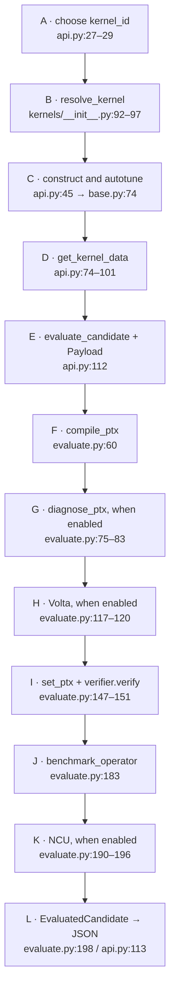

# Understanding PTX Gym: follow the code

PTX Gym accepts replacement PTX, evaluates it against a fixed Triton workload,
and returns correctness/performance feedback. Start at
[`evaluate_candidate` — api.py:105–113](../ptx_gym/api.py#L105-L113): it converts
the caller's dictionary into a `Payload`, invokes an evaluator, and returns
JSON. An external producer, such as the separate
[Triton AI Compiler](https://github.com/francois141/triton_ai_compiler), supplies
candidates. You can also supply reference PTX yourself, as
[quick_start.py:32–37](../quick_start.py#L32-L37) does.

Read this guide alongside the [HVP benchmark](softmax_ce_hvp.md) and
[local/remote runbook](run_softmax_ce_hvp.md). Source links use relative paths
with GitHub-style `#Lstart-Lend` anchors. Their labels also show file names and
line numbers: if a local viewer only opens the file, use your editor's **Go to
Line** command. References were checked against code revision `9b209466b`;
function names help you find code if lines move later. Diagram letters map to
the code table immediately below the diagram.

## 1. The repository in one map

| Responsibility | Exact place to start | What to inspect |
| --- | --- | --- |
| Public usage | [quick_start.py:16–37](../quick_start.py#L16-L37) | Get metadata → dump reference PTX → evaluate the candidate. |
| Python API | [`get_kernel_data` — api.py:68–102](../ptx_gym/api.py#L68-L102), [`evaluate_candidate`:105–113](../ptx_gym/api.py#L105-L113) | Public input/output dictionaries. |
| Workload registry | [`resolve_kernel` — kernels/__init__.py:92–97](../ptx_gym/kernels/__init__.py#L92-L97) | Convert a string identifier into an operator class. |
| Operator lifecycle | [`init_compiled_kernels` — kernels/base.py:35–74](../ptx_gym/kernels/base.py#L35-L74) | Create reference/injected JIT wrappers and optionally autotune. |
| Source/constants | [`extract_specification_from_operator` — helpers/kernels.py:155–191](../ptx_gym/helpers/kernels.py#L155-L191) | Build a `KernelSpec` from an operator. |
| PTX ABI | [`parse_ptx_signature` — helpers/ptx.py:49–104](../ptx_gym/helpers/ptx.py#L49-L104) | Read ordered parameter names/types from PTX. |
| Evaluation | [`evaluate` — evaluation/evaluate.py:49–227](../ptx_gym/evaluation/evaluate.py#L49-L227) | Stage calls and early failure returns; section 3 breaks these lines down. |
| HTTP transport | [`create_app` — server.py:61–117](../ptx_gym/server.py#L61-L117) | Routes wrap the Python API. |
| Compiler patch | [compiler/compiler.py:324–326](../triton_src/python/triton/compiler/compiler.py#L324-L326) | Substitute PTX immediately before cubin assembly. |
| Build entry point | [setup.py:8–11](../setup.py#L8-L11), [pyproject.toml:1–16](../pyproject.toml#L1-L16) | Delegate packaging to the vendored compiler build. |

Registration is explicit: [`common_list`:100–137](../ptx_gym/kernels/__init__.py#L100-L137),
[`random_kernel_list`:139–145](../ptx_gym/kernels/__init__.py#L139-L145),
[`adversial_kernel_list`:147–152](../ptx_gym/kernels/__init__.py#L147-L152), and
[`paper_kernel_list`:154–173](../ptx_gym/kernels/__init__.py#L154-L173) become
[`kernel_list`:175–177](../ptx_gym/kernels/__init__.py#L175-L177).
[`available_kernels`:84–89](../ptx_gym/kernels/__init__.py#L84-L89) builds the
name-to-class mapping. Adding a file alone does not register a task.
`adversial` is the repository's actual spelling.

The compiler and optional verifier have separate installation paths.
[`get_package_dirs`:625–627](../triton_src/setup.py#L625-L627) maps the compiler
package to `triton_src/python` and Gym to `../ptx_gym`.
[.gitmodules:1–3](../.gitmodules#L1-L3) names Volta, but the integration requires
an executable: [`volta_binary`:28–37](../ptx_gym/evaluation/volta.py#L28-L37)
raises if it is absent. Section 7 explains that optional path.

## 2. What stays fixed during an experiment?

The `(c, I, h)` contract is split between the wrapper's constructor, launch
and target lookup. Follow these source locations for the softmax example:

| Part | Meaning | Exact code |
| --- | --- | --- |
| `c` | Fixed workload configuration and compile-time values | [`__init__` — softmax.py:18–24](../ptx_gym/kernels/common/softmax.py#L18-L24) sets width/batch/block; [51–54](../ptx_gym/kernels/common/softmax.py#L51-L54) fixes input dtype; [76–77](../ptx_gym/kernels/common/softmax.py#L76-L77) supplies constexpr values. |
| `I` | Argument ABI, grid and CTA dimensions | [`forward_triton` — softmax.py:62–80](../ptx_gym/kernels/common/softmax.py#L62-L80) supplies pointer/scalar order and grid; [`Payload` — types.py:29–87](../ptx_gym/evaluation/types.py#L29-L87) validates candidate thread dimensions. |
| `h` | Target GPU and assembly environment | [`get_ptx_system_config` — environment.py:183–190](../ptx_gym/helpers/environment.py#L183-L190) reads target/ISA/address size; [`compile_ptx` — compilation.py:51–54](../ptx_gym/evaluation/compilation.py#L51-L54) selects assembler and target flags. |

The wrapper controls grid and runtime arguments at
[softmax.py:69–78](../ptx_gym/kernels/common/softmax.py#L69-L78). The model-facing
ABI is parsed from emitted PTX at [api.py:74–77](../ptx_gym/api.py#L74-L77), so
use that result instead of guessing from the Python signature. Preserve the
generated entry name and ordered argument types: the loader uses `self.name`,
the binary and compiler-derived metadata at
[compiler.py:452–468](../triton_src/python/triton/compiler/compiler.py#L452-L468).

The baseline CTA normally has `32 * num_warps` threads, computed by
[backend/compiler.py:216–231](../triton_src/third_party/nvidia/backend/compiler.py#L216-L231).
[`Payload.from_input` — types.py:90–104](../ptx_gym/evaluation/types.py#L90-L104)
accepts `num_threads_x/y/z` aliases; [50–87](../ptx_gym/evaluation/types.py#L50-L87)
checks the 1,024-thread limit and PTX `.reqntid`/`.maxntid` declarations.
[`ptx_launch_kwargs` — base.py:209–233](../ptx_gym/kernels/base.py#L209-L233)
forwards candidate CTA values. The grid remains the one in `forward_triton`.

## 3. Follow an existing softmax task from beginning to end

The example is `SoftmaxFloat16Kernel`. Its `[4096,256]` FP16 input comes from
[softmax.py:18–24](../ptx_gym/kernels/common/softmax.py#L18-L24) and
[51–54](../ptx_gym/kernels/common/softmax.py#L51-L54); its independent Torch
definition is [`forward_torch`:82–83](../ptx_gym/kernels/common/softmax.py#L82-L83).
Follow A–L in the diagram, then open the matching code-table row.



| Node | Exact call site → implementation | What to look for |
| --- | --- | --- |
| A | [`list_kernels` — api.py:27–29](../ptx_gym/api.py#L27-L29) | Identifiers are class names. Choose `SoftmaxFloat16Kernel` for this walkthrough. |
| B | [`_operator_for` — api.py:37–45](../ptx_gym/api.py#L37-L45) → [`resolve_kernel` — kernels/__init__.py:92–97](../ptx_gym/kernels/__init__.py#L92-L97) | Resolver returns a class; the second `()` at api.py:45 constructs it. |
| C | [`__init__` — softmax.py:18–24](../ptx_gym/kernels/common/softmax.py#L18-L24) → [`init_compiled_kernels` — base.py:48–74](../ptx_gym/kernels/base.py#L48-L74) | Creates JIT wrappers, then calls `self.autotune()` on the normal CUDA path. |
| D | [`get_kernel_data` — api.py:74–101](../ptx_gym/api.py#L74-L101) → [`extract_specification_from_operator` — helpers/kernels.py:155–191](../ptx_gym/helpers/kernels.py#L155-L191) | Source/constants come from inspection, ABI from emitted PTX, hardware from environment helpers. |
| E | [`evaluate_candidate` — api.py:112–113](../ptx_gym/api.py#L112-L113) → [`Payload.from_input` — types.py:90–104](../ptx_gym/evaluation/types.py#L90-L104) | Caller supplies full PTX and CTA size; `_evaluator_for` reuses the tuned operator. |
| F | [`evaluate.py:60–74`](../ptx_gym/evaluation/evaluate.py#L60-L74) → [`compile_ptx` — compilation.py:47–93](../ptx_gym/evaluation/compilation.py#L47-L93) | Assemble with target-specific `ptxas`; return early on failure. |
| G | [`evaluate.py:75–115`](../ptx_gym/evaluation/evaluate.py#L75-L115) → [`diagnose_ptx` — sanitizer.py:258–299](../ptx_gym/evaluation/sanitizer.py#L258-L299) | Pass candidate and baseline tuning config to tool subprocesses. |
| H | [`evaluate.py:117–144`](../ptx_gym/evaluation/evaluate.py#L117-L144) → [`verify_ptx_with_volta` — volta.py:52–82](../ptx_gym/evaluation/volta.py#L52-L82) | Optional specification-based verification. |
| I | [`evaluate.py:147–151`](../ptx_gym/evaluation/evaluate.py#L147-L151) → [`set_ptx` — base.py:76–83](../ptx_gym/kernels/base.py#L76-L83) → [`OutputVerifier.verify` — verification.py:201–236](../ptx_gym/evaluation/verification.py#L201-L236) | Install the injected JIT launcher and compare candidate/Triton outputs. |
| J | [`evaluate.py:183–185`](../ptx_gym/evaluation/evaluate.py#L183-L185) → [`benchmark_operator`:16–24](../ptx_gym/evaluation/evaluate.py#L16-L24) → [`evaluate_ptx_performance` — performance.py:29–51](../ptx_gym/evaluation/performance.py#L29-L51) | Generate benchmark inputs, alternate timing order, aggregate percentiles. |
| K | [`evaluate.py:190–196`](../ptx_gym/evaluation/evaluate.py#L190-L196) → [`profile_ptx_with_ncu` — ncu.py:649–676](../ptx_gym/evaluation/ncu.py#L649-L676) | Profile in a separate process after verification and timing. |
| L | [`EvaluatedCandidate(...)` — evaluate.py:198–227](../ptx_gym/evaluation/evaluate.py#L198-L227) → [`to_json` — types.py:295–304](../ptx_gym/evaluation/types.py#L295-L304) → [api.py:113](../ptx_gym/api.py#L113) | Package status/reports/timings as JSON and return a dictionary. |

This diagram follows a successful evaluation. Optional flags are set at
[evaluate.py:32–47](../ptx_gym/evaluation/evaluate.py#L32-L47). Assembly,
sanitizer, Volta and numerical failures return early at
[60–74](../ptx_gym/evaluation/evaluate.py#L60-L74),
[95–115](../ptx_gym/evaluation/evaluate.py#L95-L115),
[132–144](../ptx_gym/evaluation/evaluate.py#L132-L144) and
[168–180](../ptx_gym/evaluation/evaluate.py#L168-L180), respectively.

### B–C: Resolve, construct and create launchers

Read `return resolve_kernel(kernel_id)()` at [api.py:45](../ptx_gym/api.py#L45)
as two operations: look up the class, then call its constructor. The softmax
constructor sets dimensions/initial tuning values and calls the base method
at [softmax.py:18–24](../ptx_gym/kernels/common/softmax.py#L18-L24). The base
creates `compiled_kernel` and, when supplied PTX, `compiled_kernel_ptx` at
[base.py:58–63](../ptx_gym/kernels/base.py#L58-L63).

The static `kernel` contains the device algorithm; `forward_triton` allocates
and launches it. Compare [softmax.py:27–49](../ptx_gym/kernels/common/softmax.py#L27-L49)
with [62–80](../ptx_gym/kernels/common/softmax.py#L62-L80).
[`jit_fixed_parameters` — helpers/triton.py:136–152](../ptx_gym/helpers/triton.py#L136-L152)
adds non-constexpr, non-pointer scalar names to `do_not_specialize`, then calls
`triton.jit`. Actual compilation occurs when the JIT wrapper is launched;
creating the JIT function alone is not device compilation.

### C: Understand what autotuning verifies

The tuning space is declared at [softmax.py:13–16](../ptx_gym/kernels/common/softmax.py#L13-L16).
[`_tuning_candidates` — base.py:153–171](../ptx_gym/kernels/base.py#L153-L171)
forms its Cartesian product. [`autotune`:90–119](../ptx_gym/kernels/base.py#L90-L119)
generates fixed inputs, clones an initial Triton output, applies each config,
compares outputs and times valid configs. Rejections happen at
[120–123](../ptx_gym/kernels/base.py#L120-L123); the winner becomes
`best_config`/`tuning_result` at [136–144](../ptx_gym/kernels/base.py#L136-L144).

This verifies agreement between Triton configurations. For an independent
algorithm check, follow [`verify_triton_vs_torch` — verification.py:245–260](../ptx_gym/evaluation/verification.py#L245-L260):
it calls both `forward_triton` and `forward_torch`. The autotuner compares with
its cloned Triton reference; this verifier compares with Torch. Both checks
are needed when adding a task.

Inside the device code, [softmax.py:43–49](../ptx_gym/kernels/common/softmax.py#L43-L49)
is load → subtract maximum → exponential → sum → normalize/store. Loads have
no mask because width and block width are both 256 at
[18–21](../ptx_gym/kernels/common/softmax.py#L18-L21). Compare the HVP's
`mask = col < n_cols` and masked loads/stores at
[softmax_ce_hvp.py:117–126](../ptx_gym/kernels/common/softmax_ce_hvp.py#L117-L126):
its constructor at [27–45](../ptx_gym/kernels/common/softmax_ce_hvp.py#L27-L45)
pads the default width 1,000 to 1,024, using defaults from
[reference/softmax_ce_hvp.py:11–12](../ptx_gym/reference/softmax_ce_hvp.py#L11-L12).

### D: Extract source, constants and the PTX ABI

Follow the four assignments at [api.py:74–77](../ptx_gym/api.py#L74-L77): cached
operator → `KernelSpec` → target information → parsed PTX signature. Source
inspection/AST extraction is implemented by
[`_extract_kernel_function` — helpers/kernels.py:90–119](../ptx_gym/helpers/kernels.py#L90-L119).
Missing constexpr values are captured by temporarily replacing launchers with
a recorder in [`_extract_constexpr_values`:231–247](../ptx_gym/helpers/kernels.py#L231-L247).
The shape description goes into `KernelSpec` at
[171–188](../ptx_gym/helpers/kernels.py#L171-L188), but is absent from the
public return fields at [api.py:79–101](../ptx_gym/api.py#L79-L101).

The public [`dump_kernel_ptx` — api.py:48–50](../ptx_gym/api.py#L48-L50) calls
the object-based helper at [helpers/triton.py:94–97](../ptx_gym/helpers/triton.py#L94-L97):
generate inputs → `forward_triton` → `extract_ptx`. The final lookup is
`compiled_kernel.asm.get("ptx")` at [80–81](../ptx_gym/helpers/triton.py#L80-L81).
The API shares its operator through `@cache` at
[api.py:37–45](../ptx_gym/api.py#L37-L45) and passes it to its evaluator at
[53–58](../ptx_gym/api.py#L53-L58). Keep metadata, PTX and evaluation in the
same process to preserve that shared tuning choice.

### E–L: Submit a replacement and follow the return value

This example follows [quick_start.py:16–37](../quick_start.py#L16-L37), with the
kernel identifier changed to softmax. Comments map each call to the diagram:

```python
from ptx_gym import get_kernel_data, dump_kernel_ptx, evaluate_candidate

kernel_id = "SoftmaxFloat16Kernel"             # A
data = get_kernel_data(kernel_id)              # B–D: resolve, construct/tune, inspect
reference_ptx = dump_kernel_ptx(kernel_id)      # D: reuse the tuned operator
result = evaluate_candidate(kernel_id, {       # E–L: check, time, report
    "ptx": reference_ptx,
    "num_threads_x": data["num_warps"] * 32,
})
print(result["passed"], result["message"])      # L
```

This uses compiler-generated PTX as an installation/launcher sanity check.
For a custom evaluator, dump from its own `evaluator.operator` and use that
operator's CTA size. [`BaseCandidateEvaluator.__init__` — evaluation/base.py:17–26](../ptx_gym/evaluation/base.py#L17-L26)
stores either a supplied operator or a newly constructed one. Constructing a
different operator for the dump can trigger another tuning run; the API shares
one at [api.py:53–58](../ptx_gym/api.py#L53-L58).

## 4. Why the patched Triton build matters

Follow these implementation points to connect the Python PTX string to CUDA:

| Step | Exact source | What happens |
| --- | --- | --- |
| Accept override | [runtime/jit.py:751–752](../triton_src/python/triton/runtime/jit.py#L751-L752), [787](../triton_src/python/triton/runtime/jit.py#L787) | Accept `ptx` and store it as `self.ptx`. |
| Propagate it | [runtime/jit.py:839–851](../triton_src/python/triton/runtime/jit.py#L839-L851) | Include the candidate in cache-key/compile calls. |
| Substitute before assembly | [compiler/compiler.py:289–326](../triton_src/python/triton/compiler/compiler.py#L289-L326) | Earlier stages produce metadata; immediately before `cubin`, `module = ptx` substitutes the candidate. |
| Pack launch dimensions | [NVIDIA backend/compiler.py:216–231](../triton_src/third_party/nvidia/backend/compiler.py#L216-L231) | Pass baseline warp/CTA/shared-memory information and explicit thread dimensions. |
| Launch CUDA block | [NVIDIA backend/driver.py:316–334](../triton_src/third_party/nvidia/backend/driver.py#L316-L334) | Set `blockDimX/Y/Z` from candidate thread dimensions. |

There are two assembly paths. The standalone check assembles a temporary cubin
at [compilation.py:74–93](../ptx_gym/evaluation/compilation.py#L74-L93). Actual
execution later uses patched Triton assembly at
[compiler.py:324–326](../triton_src/python/triton/compiler/compiler.py#L324-L326).
The first check's temporary cubin is not passed to the normal Triton launcher.
Passing node F therefore does not guarantee that the later launch succeeds.

The actual loader constructs the launcher and uses compiler-derived shared
memory at [compiler.py:452–468](../triton_src/python/triton/compiler/compiler.py#L452-L468).
A replacement must fit those resources. Earlier compiler stages still run,
so the harness does not measure a model's end-to-end compilation latency.
The Gym also requires the patched `ptx` parameter in its call to `triton.jit`
at [helpers/triton.py:148–152](../ptx_gym/helpers/triton.py#L148-L152); installing
stock Triton can remove this path even if ordinary JIT kernels still work.

Installation follows [setup.py:8–11](../setup.py#L8-L11) into the vendored build.
[`get_packages` — triton_src/setup.py:653–659](../triton_src/setup.py#L653-L659)
includes compiler packages and `ptx_gym`; its native extension is declared at
[setup.py:855–856](../triton_src/setup.py#L855-L856). The uv dependency override
is explicit at [pyproject.toml:18–21](../pyproject.toml#L18-L21). CPU mathematical
references bypass this compiler installation: their Torch-only operations are
visible at [reference/softmax_ce_hvp.py:8–56](../ptx_gym/reference/softmax_ce_hvp.py#L8-L56).

## 5. What a candidate verdict actually checks

The call sites in [`evaluate` — evaluate.py:49–227](../ptx_gym/evaluation/evaluate.py#L49-L227)
are the authoritative order. This table explains each successful return:

| Stage | Exact implementation | What success establishes / limit |
| --- | --- | --- |
| Payload validation | [`Payload.__post_init__` — types.py:37–87](../ptx_gym/evaluation/types.py#L37-L87) | Nonempty PTX and allowed thread dimensions/directives; no numerical test occurs here. |
| Assembly | [`compile_ptx` — compilation.py:51–93](../ptx_gym/evaluation/compilation.py#L51-L93) | The selected assembler accepts the target and strict warning flags; memory correctness is not checked here. |
| Sanitizers | [sanitizer.py:19–24](../ptx_gym/evaluation/sanitizer.py#L19-L24), [272–299](../ptx_gym/evaluation/sanitizer.py#L272-L299) | Requested tools report clean on generated inputs; this is not equivalence for every possible input. |
| Numerical verification | [`OutputVerifier.verify` — verification.py:210–236](../ptx_gym/evaluation/verification.py#L210-L236) | Candidate and Triton agree on trials; independent Torch checking uses [238–268](../ptx_gym/evaluation/verification.py#L238-L268). |
| Timing | [`evaluate_ptx_performance` — performance.py:29–51](../ptx_gym/evaluation/performance.py#L29-L51) | Measures the two wrappers on this device with the procedure in section 6. |
| Profiling | [`profile_ptx_with_ncu` — ncu.py:715–742](../ptx_gym/evaluation/ncu.py#L715-L742) | Attempts an NCU process; inspect its status/metrics as well as Gym's `passed`. |

Tool subprocesses reconstruct operators. Sanitizer receives `best_config` at
[evaluate.py:78–83](../ptx_gym/evaluation/evaluate.py#L78-L83), serializes it at
[sanitizer.py:258–267](../ptx_gym/evaluation/sanitizer.py#L258-L267), and starts
the child at [150–168](../ptx_gym/evaluation/sanitizer.py#L150-L168). NCU follows
the same pattern at [ncu.py:699–738](../ptx_gym/evaluation/ncu.py#L699-L738).
The common [`run_candidate`:45–60](../ptx_gym/evaluation/run_candidate.py#L45-L60)
constructs `resolve_kernel(kernel_name)(ptx=launch_payload)` and generates
inputs anew. An arbitrary shape change on the parent's instance is therefore
not automatically reproduced in the child.

Defaults at [verification.py:17–29](../ptx_gym/evaluation/verification.py#L17-L29)
are 1,000 trials and seed 42. The evaluator chooses operator-specific tolerance
at [evaluate.py:149–151](../ptx_gym/evaluation/evaluate.py#L149-L151); HVP sets
`1e-6` at [softmax_ce_hvp.py:23–25](../ptx_gym/kernels/common/softmax_ce_hvp.py#L23-L25).
Generic comparison uses `equal_nan=True` at
[verification.py:80–88](../ptx_gym/evaluation/verification.py#L80-L88); HVP GPU
tests add an explicit finite-output assertion at
[test_softmax_ce_hvp_gpu.py:26–31](../tests/gpu/test_softmax_ce_hvp_gpu.py#L26-L31).

Return fields are built at [evaluate.py:198–227](../ptx_gym/evaluation/evaluate.py#L198-L227)
and serialized at [types.py:285–304](../ptx_gym/evaluation/types.py#L285-L304).
Crucially, [`EvaluatedCandidate.passed`:258–259](../ptx_gym/evaluation/types.py#L258-L259)
is just `compiles and correct`. NCU failures can be represented in a report
without changing it. The HVP full runner additionally requires successful
profiling in [`_full_report_complete` — benchmarks/softmax_ce_hvp.py:272–283](../ptx_gym/benchmarks/softmax_ce_hvp.py#L272-L283).

## 6. How to interpret timing and profiles

[`benchmark` — performance.py:10–17](../ptx_gym/evaluation/performance.py#L10-L17)
requests 200 ms warmup, 500 ms sampling and six quantiles. The 50-round
alternation is at [34–40](../ptx_gym/evaluation/performance.py#L34-L40);
[`mean_timing`:20–26](../ptx_gym/evaluation/performance.py#L20-L26) averages each
percentile across rounds. Thus `p50` is an average of round medians rather
than a median over all raw samples.

The score at [performance.py:45](../ptx_gym/evaluation/performance.py#L45) is
`triton_p50 / candidate_p50`; greater than one favors the candidate. Timed
callables at [36–40](../ptx_gym/evaluation/performance.py#L36-L40) call
`forward_triton`, which allocates output and launches at
[softmax.py:62–80](../ptx_gym/kernels/common/softmax.py#L62-L80). Input generation
is outside those callables at [evaluate.py:23–24](../ptx_gym/evaluation/evaluate.py#L23-L24).
This measures the Gym wrapper, not a complete optimizer or host/device
transfer. Self-PTX uses both timing paths; no exact-1x threshold is imposed.

For the timing boundary, inspect vendored
[`do_bench` — testing.py:149–189](../triton_src/python/triton/testing.py#L149-L189):
it calls/synchronizes before estimating and warming up, then records events
around repeated calls. First-use compilation is warmed up. Sanitizer and
profiling are separate stages at [evaluate.py:75–83](../ptx_gym/evaluation/evaluate.py#L75-L83)
and [190–196](../ptx_gym/evaluation/evaluate.py#L190-L196). NCU's separate process
and status are visible at [ncu.py:715–742](../ptx_gym/evaluation/ncu.py#L715-L742)
and [`NCUResult.to_dict`:637–646](../ptx_gym/evaluation/ncu.py#L637-L646). Keep
those reports with device/toolchain information when interpreting latency.

[`clear_triton_cache` — helpers/triton.py:29–44](../ptx_gym/helpers/triton.py#L29-L44)
reads `TRITON_CACHE_DIR` and deletes that directory. Calls occur at
[evaluate.py:53](../ptx_gym/evaluation/evaluate.py#L53) and
[performance.py:30](../ptx_gym/evaluation/performance.py#L30). Use a dedicated
experiment cache so these calls do not clear one used by other work.

## 7. HTTP and optional formal verification

Start HTTP with `python -m ptx_gym.server --host 127.0.0.1 --port 5000`; the
options/server start are at [server.py:120–135](../ptx_gym/server.py#L120-L135).
Handlers at [83–115](../ptx_gym/server.py#L83-L115) expose `/health` and POST
endpoints `/list_kernels`, `/is_gpu_available`, `/get_kernel_data`,
`/dump_kernel_ptx` and `/evaluate_candidate`. Compare each handler with its
API call: this transports the same operation, rather than implementing
another evaluator.

GPU routes call `_run_on_gpu` at [server.py:98–115](../ptx_gym/server.py#L98-L115),
which acquires `_GPU_LOCK` at [52–58](../ptx_gym/server.py#L52-L58). That lock
only serializes one process; the server launch uses threads at
[127–135](../ptx_gym/server.py#L127-L135). `create_app` at
[61–117](../ptx_gym/server.py#L61-L117) has no authentication layer, so use the
default loopback binding plus an SSH tunnel for a personal remote experiment.

Volta defaults to disabled at [evaluate.py:37–39](../ptx_gym/evaluation/evaluate.py#L37-L39).
Enabling it checks the binary and specification at
[45–47](../ptx_gym/evaluation/evaluate.py#L45-L47).
[`volta_binary` — volta.py:28–37](../ptx_gym/evaluation/volta.py#L28-L37) locates
the executable; [`verify_ptx_with_volta`:52–76](../ptx_gym/evaluation/volta.py#L52-L76)
adds launch/shared-memory arguments, `--sample 4` via the constant at
[25](../ptx_gym/evaluation/volta.py#L25), and `--verify-numeric`. Interpret its
guarantee with that actual specification/invocation. Existing softmax supplies
its specification at [`volta_arguments` — softmax.py:85–114](../ptx_gym/kernels/common/softmax.py#L85-L114).
HVP wrappers inherit the unsupported base implementation at
[base.py:235–243](../ptx_gym/kernels/base.py#L235-L243).

## 8. A code-reading checklist for a new task

Use these concrete entry points when reading or adding a task:

| Question | Follow this code |
| --- | --- |
| What does the operation compute? | Compare [`kernel` — softmax.py:27–49](../ptx_gym/kernels/common/softmax.py#L27-L49) with [`forward_torch`:82–83](../ptx_gym/kernels/common/softmax.py#L82-L83). |
| Which configuration defines the task? | Read [constructor:18–24](../ptx_gym/kernels/common/softmax.py#L18-L24), [tuning options:13–16](../ptx_gym/kernels/common/softmax.py#L13-L16), and [input generator:51–54](../ptx_gym/kernels/common/softmax.py#L51-L54). |
| What is launched, with which ABI/grid? | Read [`forward_triton`:62–80](../ptx_gym/kernels/common/softmax.py#L62-L80), [`ptx_launch_kwargs` — base.py:209–233](../ptx_gym/kernels/base.py#L209-L233), then [ABI extraction — api.py:77](../ptx_gym/api.py#L77). |
| Are tails, dtypes and difficult inputs covered? | Inspect [HVP GPU cases:17–33](../tests/gpu/test_softmax_ce_hvp_gpu.py#L17-L33), [special values:73–88](../tests/gpu/test_softmax_ce_hvp_gpu.py#L73-L88), and [masked device code:117–126](../ptx_gym/kernels/common/softmax_ce_hvp.py#L117-L126). |
| Is the task registered and PTX round-trip tested? | Compare [registry entries:129–134](../ptx_gym/kernels/__init__.py#L129-L134) with [registration/round-trip checks:36–51](../tests/gpu/test_softmax_ce_hvp_gpu.py#L36-L51). |
| Do metadata and PTX share one tuned operator? | Follow [API cache:37–58](../ptx_gym/api.py#L37-L58) and the runner's [three public calls:295–308](../ptx_gym/benchmarks/softmax_ce_hvp.py#L295-L308). |
| Which stage failed, and can I trust the score? | Follow [early returns — evaluate.py:60–180](../ptx_gym/evaluation/evaluate.py#L60-L180), [result fields:198–227](../ptx_gym/evaluation/evaluate.py#L198-L227), and [full-report criterion:272–283](../ptx_gym/benchmarks/softmax_ce_hvp.py#L272-L283). |
